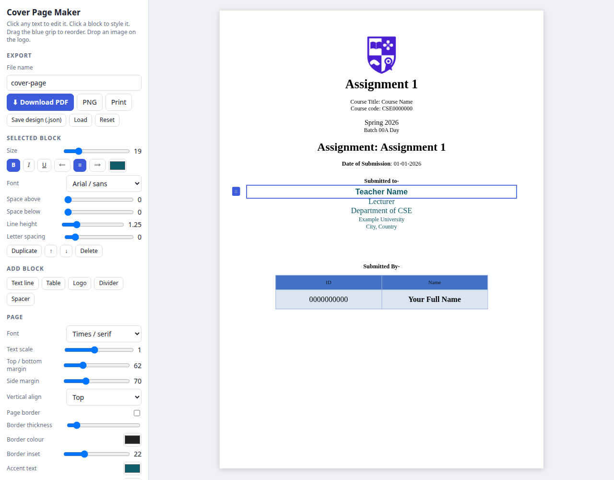
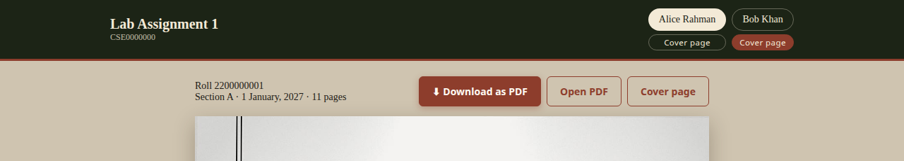

# ai-hand-writing-generator

Turn typed assignment answers into **realistic handwritten, scanned-looking A4 pages** and a print-ready **PDF per student** - with different handwriting, margins and page design for every student.

Write the questions and answers once in plain JavaScript, describe each student in a small profile, run one command, and get:

- a PDF named `ROLL-NAME-BATCH-ASSIGNMENT_NAME.pdf` (all uppercase)
- the page images (JPG, 1240x1754 = 150 dpi A4)
- a web preview with a **Download as PDF** button
- an **editable A4 cover page maker** (drag & drop logo, every field editable, PDF / PNG export)

| Student A | Student B | Output screenshots |
|---|---|---|
|  |  |  |

*(The sample students "Alice" and "Bob" are made up.)*

## Features

- **Natural handwriting**: Gloria Hallelujah / Kalam fonts with per-word tilt, size and spacing, a pen "wobble" filter, uneven line pressure, stray pen dots, ticks and blots.
- **Scanner look**: flash, vignette, grain and slight page rotation, then a JPEG-compressed PDF.
- **Realistic layout**: top margin like a notebook, single or double margin lines, random blank space at the bottom of each page, uneven gaps between questions, no page numbers, title block on page 1 only.
- **Terminal screenshots**: black "emulator" windows (two styles) with your program output, placed on the last pages.
- **Handwritten digits fixed**: the fonts' own `9` looks like a `q`, so every 9 is drawn as a turned 6.
- **Reusable**: assignments, students and styling are separate files; add either without touching the engine.

## Requirements

- Node.js 20+ and npm
- Python 3 (with `venv`) - for the scanner effect and PDF (Pillow, NumPy)
- Chromium (installed by Playwright)

## Quick start

```bash
git clone https://github.com/awebcode/ai-hand-writting-generator.git
cd ai-hand-writting-generator
npm run hw:setup        # once: npm install, python venv (pillow, numpy), chromium
npm run hw:preview      # builds the example, then serves the preview on http://localhost:8080
```

Other commands:

```bash
npm run hw:build                    # build the example assignment
npm run hw:build -- example alice   # one assignment, one student
npm run hw:new -- lab2              # new assignment from the template
npm run hw:new-student -- carol     # new student profile from the template
HW_ASSIGNMENT=lab2 npm run hw:preview
```

Output goes to `public/<outDir>/` (PDFs and `<student>/NN.jpg`). The preview page lists the last build.

## Handwrite Studio (web app)

A fully client-side app in `site/`: home page, a drag-and-drop **editor** and the **cover page maker**.

- Blocks: questions, answers, points, code, tables, terminal screenshots, pasted / dropped images (auto-resized), spacers, page breaks.
- Handwriting: 9 handwriting fonts plus standard fonts, skew, tilt, wobble, random pen dots, margins and a scanner look; header layouts and templates.
- Undo / redo (Ctrl+Z), autosave per browser (IndexedDB), project import / export, download as PDF / PNG zip / JPG zip named `ROLL-NAME-BATCH-TITLE`.
- State lives in a [zustand](https://github.com/pmndrs/zustand) vanilla store; there is no build step.

```bash
npm install
npm run dev          # http://localhost:8080  (editor at /editor/, cover at /cover/)
```

### Deploy to Cloudflare Pages

`wrangler.jsonc` sets `pages_build_output_dir: ./site`, and `site/_headers` sets the security headers and caching.

```bash
npm run vendor       # refresh site/vendor from node_modules (already committed)
npm run cf:dev       # local Pages preview
npm run cf:deploy    # wrangler pages deploy site
```

Or connect the repo in the Cloudflare dashboard (Workers & Pages -> Create -> Pages -> Connect to Git): framework preset None, build command `npm run build` (a no-op), build output directory `site`.

## Cover page maker

An editable **A4 cover page** (logo, title, course, batch, date, "Submitted to", "Submitted by" table) that you can customise in the browser and download as PDF or PNG.





```bash
npm run cover        # then open http://localhost:8080/cover/
```

- **Everything is editable in place** - click any line, label or table cell and type. Ctrl+B / I / U work inside a line.
- **Click any block** and a small action bar appears on it: Edit, bold / italic / underline, bigger / smaller, align, colour, move up / down, duplicate and **Delete** (logo: Replace / Remove; table: add or remove rows and columns). The side panel has the finer controls: size, bold / italic / underline, colour, font, alignment, space above / below, line height, letter spacing.
- **Drag the blue grip** to reorder blocks; **add** text lines, tables, logos, dividers and spacers; duplicate or delete any block.
- **Logo**: drag & drop an image onto the page (or onto the logo), or click *Replace*. Remove it or go back to the default shield.
- **Table**: add / remove rows and columns, change width, text sizes, row height, header and row colours.
- **Page**: font, text scale, margins, vertical alignment, optional page border, accent / table / paper colours, zoom.
- **Download bar (top right)**: file name, format (**PNG by default**, or PDF) and a **Download** button; the **⋯** menu has Print, Copy link, Save design (.json), Load design and Reset. PNG is 2x (1588 x 2244); PDF is exact A4. With the preview server running the PDF has real vector text; without it the page renders the file in the browser instead.
- **Per-student cover pages**: the preview page shows a **Cover page** button under each student (and next to Download as PDF). It opens `/cover/` prefilled with that student's name, roll, batch, date, course, instructor and so on, and every field stays editable. Your edits are remembered per link.
- **Your own default content**: put a saved design at `site/cover/preset.local.json` (git-ignored) and it loads automatically on first open.

### Fill the cover page from the URL

Every field can be set with a query parameter, so you can link, bookmark or script cover pages:

```
/cover/?title=Lab+Assignment+1&course=Course+Name&code=CSE0000000&term=Fall+26&batch=00A+Day
      &assignment=Lab+Assignment+1&date=01-01-2027&teacher=Teacher+Name&role=Lecturer
      &dept=Department+of+CSE&university=Example+University&city=Dhaka
      &id=2200000001&name=Alice+Rahman&file=MY-COVER&download=png
```

| param | field |
|---|---|
| `title` | big title (default `Assignment 1`) |
| `course` `code` | course title and code |
| `term` `batch` | semester line and batch line |
| `assignment` | the "Assignment: ..." line |
| `date` | date of submission |
| `teacher` `role` `dept` `university` `city` | "Submitted to" block |
| `id` `name` (`id2` `name2` ... up to 6 rows) | "Submitted by" table rows |
| `logo` | logo image URL (or drop an image on the page) |
| `file` | download file name |
| `download` | `png` or `pdf`: start the download as soon as the page opens |
| `font` `accent` `head` `row` `border` `zoom` | page font, accent colour, table colours, `border=1` for a page frame, zoom |

The instructor, course, term and city for the preview buttons come from your assignment file (`instructor`, `instructorRole`, `course`, `term`, `city`, ...), and `batchLabel` from each student profile.

PNG / PDF are rendered in the browser with the vendored html2canvas and jsPDF, so the cover maker also works as a static site.

## Project layout

```
tools/hwbuild/
  build.mjs                 engine: render, paginate, scan effect, PDF
  scanify.py                scanner effect + JPEG PDF writer
  lib/blocks.mjs            helpers: P, L, R, TABLE, SHOT, CODE
  lib/compile.mjs           assignment + profile -> pages
  profiles/<student>.mjs    who writes: details, handwriting, page design
  assignments/<name>/       what is written: questions + one answer per student
  assignments/_template/    copy this for a new assignment
  profiles/_template.mjs    copy this for a new student
  preview.mjs               tiny dependency-free preview server
  fonts/                    Gloria Hallelujah, Kalam, VT323 (SIL OFL)
preview/index.html          preview page (student tabs, page images, Download as PDF)
site/                       Handwrite Studio web app (static, no build step)
  index.html                home page
  editor/                   drag-and-drop handwriting editor
  cover/                    cover-page maker
  src/features/*            home, editor, handwriting engine, cover
  src/shared/*              reusable helpers (history, storage, images, forms)
  vendor/                   html2canvas, jsPDF, JSZip, zustand (vendored)
```

## Write an assignment

```js
// tools/hwbuild/assignments/lab2/assignment.mjs
import { P, L, R, TABLE, SHOT, CODE } from "../../lib/blocks.mjs";

export default {
  slug: "lab2", title: "Lab Assignment 2", course: "Course Name", courseCode: "CSE0000000",
  university: "Example University", dept: "Department of CSE", term: "Fall 26",
  students: ["alice", "bob"],
  sections: [{ from: 0, key: "theory" }],
  questions: [
    {
      q: "What is an assembler directive?",          // numbering is added automatically
      a: {
        alice: [P("Ans. A message to the assembler."), L("(i) .DATA - starts the data segment")],
        bob:   [P("Answer: A command for the assembler."), L("1. .CODE - starts the code segment")],
        // CODE(`...`) -> handwritten code, SHOT(["line 1", "line 2"]) -> terminal screenshot
      },
    },
  ],
};
```

Use `default:` instead of a student id to share one answer between students.

## Add a student

`npm run hw:new-student -- <id>` then edit `profiles/<id>.mjs`:

| setting | what it does |
|---|---|
| `name` `roll` `section` `batch` `date` | printed in the header and the PDF name |
| `font` `fs` `lh` `ink` | `gloria` or `kalam`, size, line height, ink colour |
| `grade` + `hand: {...}` | base shakiness (`clean`/`medium`); override `rot dy skew szLo szHi ls0 ls1 mr0 mr1 line opLo boldP` |
| `wobble` `wobbleFreq` | letter-shape roughness (higher = rougher) |
| `marks: {dots, ticks, scribble, blots, margin}` | stray pen dots, ticks, scribbles, blots; `margin:false` = clean left margin |
| `layout.rules / pad / css` | margin lines, page padding, header/section/question styling |
| `layout.gapMin gapMax gapQ` | random blank paper at page bottom; random gap above each question |
| `qLabel` `sectionNames` `shotCaption` `header` | numbering style, section titles, screenshot captions, title block |
| `shotStyle` | `a` grey window, `b` black terminal |

## Privacy

Real student data (names, roll numbers), source attachments, generated PDFs and page images are **git-ignored** - keep real assignments in `tools/hwbuild/assignments/<name>/` and `profiles/<id>.mjs` locally. Only the made-up `example` assignment is committed.

## Notes

- The preview is a single static page served by a 40-line Node script; the generator itself only needs Node, Python and Chromium.
- Set `PORT=3000` to change the preview port, or `CHROME_PATH` to use an existing Chromium.
- Use it for practice, demos and design experiments. Submitting generated work as your own where handwriting or original work is required may break your school's rules.

## License

MIT for the code. The bundled fonts are licensed under the SIL Open Font License.
